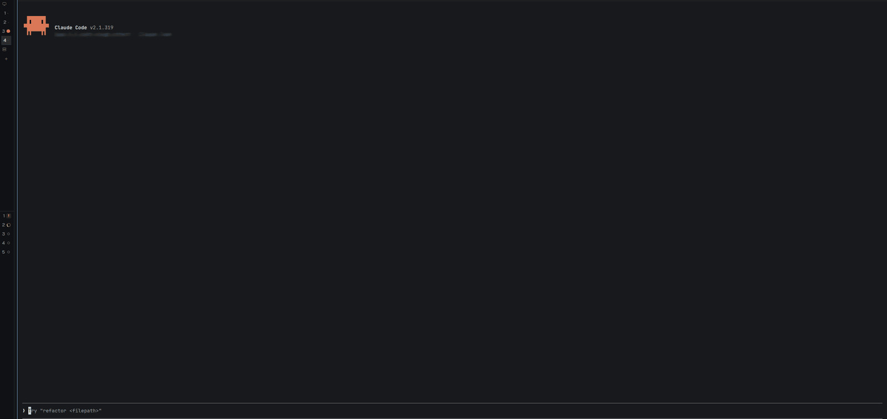
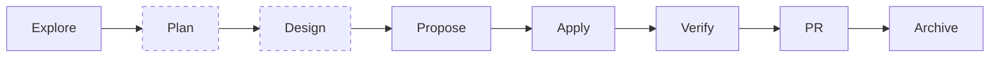

# opsx-board

**See where your OpenSpec change stands, live, in a pane beside the Claude Code chat.**

opsx-board follows the [OpenSpec](https://github.com/Fission-AI/OpenSpec) workflow of your
session while you work: the stage your change is in, the task groups that are done, the agent
working on each group, the tokens each step costs, and the command that comes next. It works
with any OpenSpec schema.

[](https://github.com/uzi0espil/opsx-board/actions/workflows/ci.yml)
[](https://github.com/uzi0espil/opsx-board/releases)
[](LICENSE)

[Install](#install) · [Use](#use) · [The board in detail](docs/board.md) ·
[board.yaml](docs/board-yaml.md) · [Contributing](CONTRIBUTING.md)



## Why use it?

An OpenSpec change runs over many commands, agents, and sessions. The chat shows the last turn,
not where the change stands. The board keeps that in view:

- **The whole lifecycle at a glance.** Explore, Propose, Apply, Verify, PR (MR on GitLab), and
  Archive, with the stage in progress marked.
- **Live apply progress.** A progress bar of the tasks, and each task group with the agent that
  runs it, its tokens, and its commit.
- **The next step, ready to send.** Next fills the prompt with the next `/opsx:` command. You
  send it; the board never runs it.
- **Read without leaving the terminal.** A click opens the proposal, the tasks, a spec, or an
  issue in the pane.
- **What a change costs.** Tokens per stage, added up over every session of the change.
- **Your schema, your stages.** The board takes the stages from your OpenSpec schema. A
  `board.yaml` adds a Plan stage of backlog items or GitHub issues, and a Design stage.

## How it works



The dashed stages come from a [`board.yaml`](#add-stages-with-boardyaml). The PR stage needs
`gh` for a repository on GitHub, or `glab` for one on GitLab, where it is the MR stage.

The board watches; it does not steer. It reads the `openspec` CLI, the files of the change, git,
`gh`, `glab`, and the events of your session: commands, agents, and tokens. It redraws as they
change, and it changes no file of the workflow.

Each session follows its own change: the argument of its last `/opsx:` command, else the only
active change in its folder, else the change its branch names, else the one you pick in the
pane. It follows the session into a worktree and out of it.

## Install

You need Claude Code and the `openspec` CLI on the `PATH`. `gh` and `glab` are optional.
Without the CLI of the repository's host, `gh` for GitHub or `glab` for GitLab, the board shows
no PR stage. Without `gh`, GitHub issues show no state.

In Claude Code 2.1.275 or later:

```
/plugin install opsx-board --marketplace uzi0espil/opsx-board
```

In an earlier version, add the marketplace first:

```
/plugin marketplace add uzi0espil/opsx-board
/plugin install opsx-board@opsx-board
```

## Use

Run any `/opsx:` command, or the design command of your `board.yaml`. The pane opens by itself
when the terminal is wide enough. When the pane is closed, a status line under the prompt shows
the stage.

| Command | What it does |
| --- | --- |
| `/opsx-board` | Opens the pane |
| `/opsx-board <change>` | Pins the pane to a change, also an archived one |
| `/opsx-board auto` | Lets the session choose the change again |
| `/opsx-board close` | Closes the pane |

Every row acts on a click: a section folds, an artifact opens in the pane, an agent opens its
session (`← Main session` brings you back), the PR or MR opens in the browser, and Next fills
the prompt. See [Clicks](docs/board.md#clicks).

During `/opsx:apply`, the board asks the agents to report the task they work on, so the pane
marks the exact task in progress. Turn this off with **Progress report tool** in `/config`.

## Add stages with board.yaml

Without a `board.yaml`, the board shows the stages of OpenSpec. A `board.yaml` adds what
OpenSpec does not know. This one takes the work items of a change from GitHub issues, for any
schema:

```yaml
version: 1

stages:
  - { id: plan, label: Issues, collects: work-item, section: Issues }

refs:
  - { kind: work-item, provider: github, branch: '^(\d+)-' }
```

Put it beside the schema, at `openspec/schemas/<schema>/board.yaml`, or keep your own copy at
`~/.claude/opsx-board/schemas/<schema>/board.yaml`. A `board.yaml` can also add a Design stage,
take work items from backlog files, and read the verdict of a review artifact. See
[board.yaml](docs/board-yaml.md).

## What it touches

- **Reads** the repository of the session, through the `openspec` CLI, git, `gh`, and `glab`, and
  its own folder, `~/.claude/opsx-board/`.
- **Writes** only its token ledgers, under `~/.claude/opsx-board/`.
- **Runs no workflow command.** Next fills the prompt; you decide to send it.
- **Checks a `board.yaml` strictly**, because it comes with a repository: built-in providers
  only, paths inside the repository, and short patterns. See [The check](docs/board-yaml.md#the-check).

[SECURITY.md](SECURITY.md) lists everything the plugin does in a session.

## Status

Work in progress. Work items come from files of the repository or from GitHub issues, and a Jira
provider comes next. See the [releases](https://github.com/uzi0espil/opsx-board/releases) for
what changed.

opsx-board is not affiliated with Anthropic or the OpenSpec project.

## Documentation

- [The board in detail](docs/board.md): stages, clicks, the reader, apply runs, Next, and tokens.
- [board.yaml](docs/board-yaml.md): the stages, references, verdicts, and commit patterns it
  adds, GitHub issues, and its checks.
- [Contributing](CONTRIBUTING.md): set up, tests, pull request titles, and releases.
- [Security](SECURITY.md): what the plugin does in a session, and how to report a vulnerability.

## Help and feedback

Use [GitHub Issues](https://github.com/uzi0espil/opsx-board/issues) for bugs and ideas. Report a
vulnerability through
[private vulnerability reporting](https://github.com/uzi0espil/opsx-board/security/advisories/new),
not an issue.

## License

[MIT](LICENSE)
